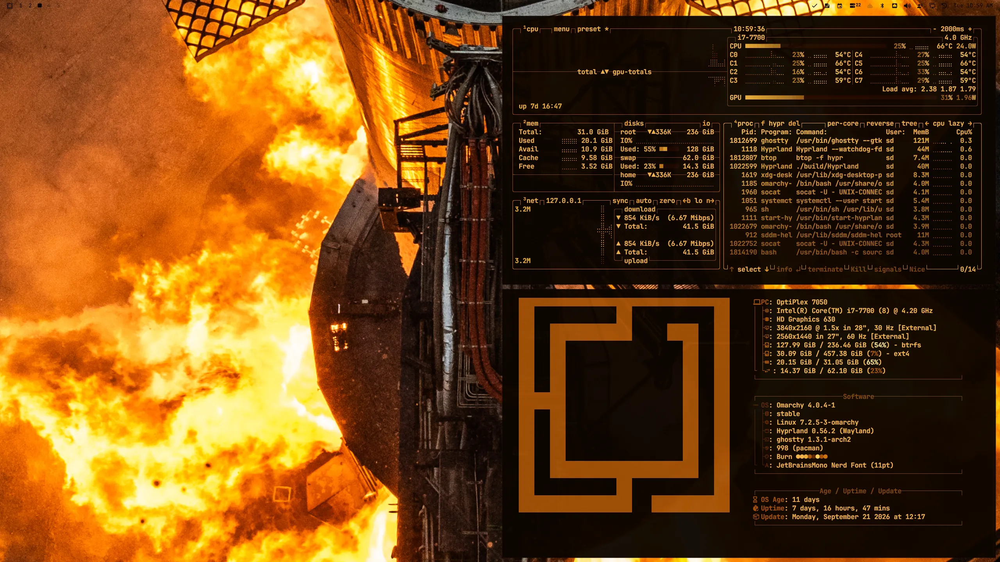
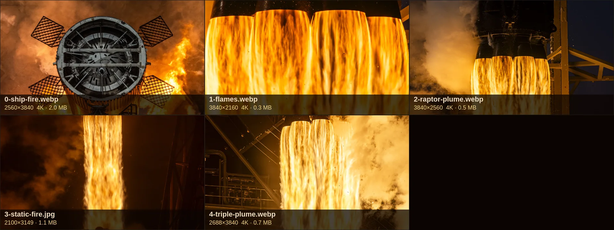

# Burn

Omarchy theme from a Super Heavy night static fire. Ember void, flame gold, square corners, hairline borders.

Repo: [stevederico/omarchy-burn-theme](https://github.com/stevederico/omarchy-burn-theme).

Sister theme: [Space](https://github.com/stevederico/omarchy-space-theme), Starship launch in sunlit steam. Burn split from it.



## Palette

| Role | Hex |
|------|-----|
| Background | `#0C0500` |
| Card | `#1F0800` |
| Text | `#F3B34B` |
| Accent | `#EB9E2D` |
| Ember | `#CC730E` |
| Core | `#FFE894` |

## Install

User theme (keeps `hyprland.lua`):

```bash
git clone https://github.com/stevederico/omarchy-burn-theme.git ~/.config/omarchy/themes/burn
rm -rf ~/.config/omarchy/themes/burn/.git
omarchy theme set burn
```

`omarchy theme install` from a git URL drops `*.lua`. Copy as a user theme if you want square corners and the 1px hairline.

Backgrounds cycle with Super+Ctrl+Space.

## Backgrounds



| File | Size | Shot | Source |
|------|------|------|--------|
| `0-ship-fire.webp` | 3840×5761 (4K) | Ship overhead in fire, default | [X orig](https://pbs.twimg.com/media/G0Q4MVmbcAANGka?format=jpg&name=4096x4096) |
| `1-flames.webp` | 3840×2160 (4K) | Raptor nozzles and flame | Studio desktop |
| `2-raptor-plume.webp` | 3840×2560 (4K) | Raptor bells firing | [X orig](https://pbs.twimg.com/media/G3_S4kWWYAAqLkX?format=jpg&name=4096x4096) |
| `3-static-fire.webp` | 3840×5758 (4K) | Super Heavy plume at night | [X orig](https://pbs.twimg.com/media/HIGiE3yaQAAEJGu?format=jpg&name=4096x4096) |
| `4-triple-plume.webp` | 3840×5486 (4K) | Triple Raptor plume | [X orig](https://pbs.twimg.com/media/Gs0jV9NWEAA5oOF?format=jpg&name=4096x4096) |

(4K) backgrounds are upscaled from the originals with Topaz High Fidelity V2 on Replicate (2x for `0-ship-fire`, `2-raptor-plume` and `3-static-fire`, 4x for `1-flames` and `4-triple-plume`, then 2x again for `4-triple-plume`), then lanczos down to 3840 wide.

Photos © SpaceX.
